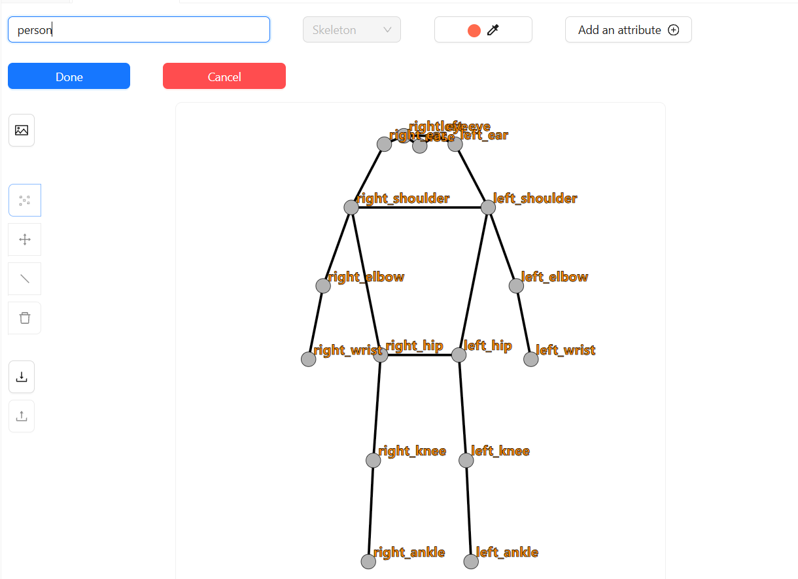
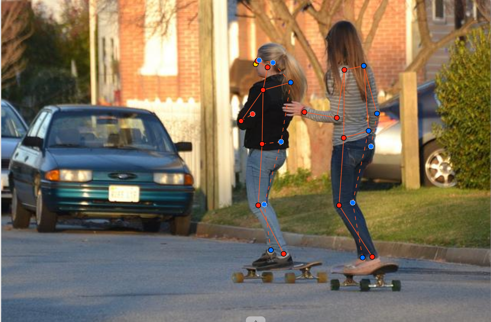
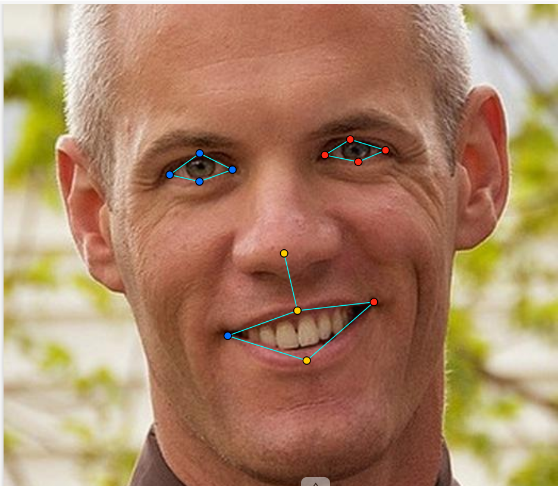
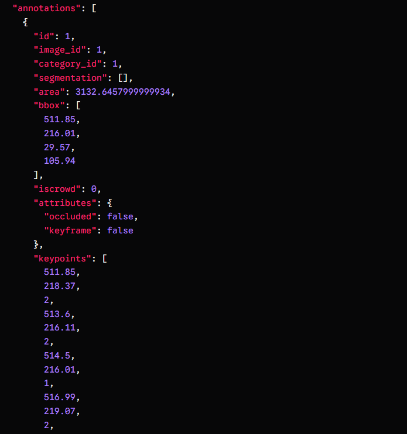

# Báo cáo cá nhân — NguyenHongSon-2A202603098

Đổi tên file theo quy tắc `MSSV_HoTen.md`. Ví dụ: `20241234_NguyenVanAn.md`.

Dữ liệu: 12 ảnh người COCO val2017 (Lin et al., 2014) và 8 ảnh chân dung Wikimedia Commons, chỉ dùng trong lớp.

## 0. Thông tin học viên

- Họ tên: Nguyễn Hồng Sơn
- MSSV: 2A202603098
- Email: 0917077890son@gmail.com
- Link repository: https://github.com/ShirogonRyu/K5-L2-DAY04-NguyenHongSon-2A202603098-KeypointPose
- Phiên bản CVAT (Help → About): 2.74.1
- Máy: hệ điều hành Windows · RAM 16 GB · chạy CVAT chế độ đầy đủ 
- Bộ ảnh (`src/exports/assignment.json` do `lab.py setup` tạo): có 
- Giờ bắt đầu: 16h30
- Giờ kết thúc: 19h00

## 1. Kiểm tra label (CP0)

| Label | Kiểu | Số điểm | Tên điểm đúng bảng của lab? | Đúng thứ tự? | Số cạnh |
|---|---|---:|---|---|---:|
| `person` | Skeleton | 17 | Có | Có | 19 |
| `face` | Skeleton | 13 | Có | Có | 13 |

Mẫu `person` dựng theo người quay mặt về camera (các điểm `left_*` nằm bên phải khung mẫu)? Có

Cách đổi cờ `occluded` / `outside` cho **một điểm** trên phiên bản CVAT này (một câu):

Rê chuột vào đúng một điểm rồi bấm phím `Q` (`occluded`) hoặc `O` (`outside`), hoặc chuột phải trực tiếp vào điểm đó để bật cờ tương ứng (không dùng phím `H`/`hidden`).

## 2. Số lượng đã gán và thời gian (CP1, CP2)

| Nhóm ảnh | Số ảnh | Số skeleton đã gán | Số người dưới 60 px (không gán) | Số poster / gương / màn hình bỏ qua | Thời gian (phút) |
|---|---:|---:|---:|---:|---:|
| `easy` | 5 | 5 | 0 | 0 | 25 |
| `occluded` | 3 | 5 | 0 | 0 | 25 |
| `back` | 2 | 4 | 0 | 0 | 20 |
| `small` | 1 | 2 | 0 | 0 | 10 |
| `crowd` | 1 | 3 | 0 | 0 | 15 |
| `faces` | 8 | 8 | — | 0 | 25 |

- Số ảnh người đã xong ở mốc phút 105: 10 / 10
- Thời gian thực tế (phút): CP1 95 · CP2 25 · CP3 20
- Ảnh tốn thời gian nhất là ảnh nào, vì sao?

Ảnh `000000542160.jpg` (nhóm `crowd`) và `000000521817.jpg` (nhóm `occluded`) tốn nhiều thời gian nhất vì có nhiều người đứng gần nhau, nhiều khớp bị che khuất và tư thế phức tạp (ngồi xếp bằng, quay người), đòi hỏi phải phóng to để xác định chính xác từng khớp và cờ `occluded`/`outside`.

## 3. Bảng ca khó (CP1, CP2)

Mỗi điểm bạn phân vân một dòng, nhất là phân vân giữa `v = 1` và `v = 0`, hoặc không chắc hướng người.

| Ảnh | Người / mặt | Điểm | Cờ đã chọn | Phân vân giữa | Lý do chọn |
|---|---|---|---:|---|---|
| `000000521817.jpg` | Người áo ba lỗ | `left_ear` | 1 | `v = 1` và `v = 0` | Đầu nghiêng về phía camera, tai trái bị khuất sau đầu nhưng ước lượng được vị trí đối xứng qua sống mũi và mắt, nên chọn `v = 1`. |
| `000000311300.jpg` | Cô gái trượt ván | `right_ankle` | 1 | `v = 1` và `v = 2` | Chân phải đi giày cao cổ che mất mắt cá, nhưng thấy rõ hướng cẳng chân nên ước lượng chắc chắn tâm khớp mắt cá trong giày, chọn `v = 1`. |
| `face_301643.jpg` | Mặt đeo kính râm | `left_eye_upper`, `left_eye_lower` | 1 | `v = 1` và `v = 0` | Tròng kính đen che kín mắt không thấy mí, nhưng gọng kính định hình rõ hốc mắt, ước lượng chắc chắn theo gọng nên chọn `v = 1` theo guideline. |
| `000000106051.jpg` | Người ở xa | `left_wrist` | 0 | `v = 1` và `v = 0` | Cánh tay bị vật cản phía trước che khuất hoàn toàn, không có góc tựa để suy đoán vị trí bàn tay nên đánh dấu `outside` (`v = 0`). |

## 4. Bảng tự review (CP3)

Đi từ ảnh cuối về ảnh đầu. 5 ảnh người (ít nhất 2 ảnh `back` hoặc `crowd`) và 3 ảnh mặt. Ít nhất 8 dòng, kể cả dòng `ok`. Ghi lỗi trước, sửa sau.

Mã lỗi dùng đúng một trong: `lr_swap`, `vis_flag`, `position`, `missing`, `extra`, `ok`.

| Ảnh | Người / mặt | Điểm | Mã lỗi | Ghi chú | Đã sửa? |
|---|---|---|---|---|---|
| `000000542160.jpg` | Người đứng giữa (#2) | `knee`, `ankle` | `ok` | Tư thế đứng hai chân hơi sát nhau, đã kiểm tra đúng chân trái bên phải ảnh và chân phải bên trái ảnh, không bị ngược. | — |
| `000000521817.jpg` | Người áo xanh (#2) | `left_ankle`, `right_ankle` | `ok` | Người ngồi khoanh chân xếp bằng đối diện camera nên hai cẳng chân bắt chéo nhau tự nhiên, vị trí đặt khớp đúng. | — |
| `000000518966.jpg` | Người đi bộ | Toàn thân | `ok` | Người quay lưng về camera, các điểm `left_*` đã nằm đúng phía bên trái ảnh. | — |
| `000000311300.jpg` | 2 người trượt ván | `ankle` | `ok` | Hai người đứng tư thế một chân trước một chân sau trên ván, đường chân bắt chéo theo góc chụp xiên, không bị swap. | — |
| `000000106051.jpg` | Người ở xa (#1) | `left_hip`, `right_hip` | `position` | Ban đầu đặt hông hơi cao theo cạp quần, đã zoom to và chỉnh lại đúng khớp xương chậu. | Có |
| `face_301643.jpg` | Mặt kính râm | 4 điểm mắt | `ok` | 4 điểm mí mắt và khóe mắt đã bật `occluded` (`v = 1`), đặt đúng theo gọng kính. | — |
| `face_145621.jpg` | Mặt nghiêng | `right_eye_inner` | `ok` | Mắt xa bị sống mũi che một phần khóe trong, đã căn đúng mép sống mũi. | — |
| `face_562485.jpg` | Mặt tóc che | `lip_upper` | `position` | Điểm giữa môi trên bị lệch nhẹ sang phải do góc cười nhếch mép, đã kéo lại chính giữa viền môi. | Có |

Tổng hợp số lỗi theo mã:

| `lr_swap` | `vis_flag` | `position` | `missing` | `extra` | `ok` |
|---:|---:|---:|---:|---:|---:|
|0 | 0|2 |0 | 0|6 |

Điểm còn phân vân giữa `v = 1` và `v = 0` (ghi cả hai lựa chọn và lý do chọn):

- Ở ảnh 000000521817.jpg, điểm left_ear bị khuất sau đầu khi nhìn từ góc này: chọn v = 1 vì có thể căn theo đối xứng tai phải qua trục khuôn mặt; nếu áp dụng quy tắc khắt khe hơn không đoán điểm bị khuất hoàn toàn thì có thể chọn v = 0.

## 5. Kiểm file xuất và kết quả tự kiểm (CP4)

Tự kiểm tay trong file JSON:

| File | Người / mặt kiểm (ảnh, thứ tự) | Số phần tử `keypoints` | Điểm `outside` ra `v = 0`, `occluded` ra `v = 1`? | `num_keypoints` khớp? |
|---|---|---:|---|---|
| `NguyenHongSon_persons.zip` | `000000106051.jpg`, người #1 (`id=1`) | 51 | Có (`v=0`: 2, `v=1`: 6, `v=2`: 9) | Có (`15` = 15 bộ `v > 0`) |
| `NguyenHongSon_persons.zip` | `000000106051.jpg`, người #2 (`id=2`) | 51 | Có (`v=0`: 4, `v=1`: 5, `v=2`: 8) | Có (`13` = 13 bộ `v > 0`) |
| `NguyenHongSon_faces.zip` | `face_301643.jpg`, mặt #1 (`id=4`) | 39 | Có (`v=1`: 8, `v=2`: 5) | Có (`13` = 13 bộ `v > 0`) |

Sau khi xuất, CVAT ghi `occluded` thành `v = 1` và `outside` thành `v = 0`. Tọa độ của điểm `outside` trong file là `0, 0` hay tọa độ cũ? tọa độ cũ (ví dụ `(506.18, 245.7)` với `v = 0`)

Hai job đã chuyển sang completed trên CVAT? Có

Dán phần **TÓM TẮT** in ra từ `src/check_submission.py`:

```text
----- TÓM TẮT (dán vào báo cáo mục 5) -----
- File person: NguyenHongSon_persons.zip
  Số ảnh: 12 · số skeleton `person`: 19 · mỗi annotation 51 số
  Skeleton theo ảnh: 000000106051=2, 000000189365=1, 000000205650=1, 000000211458=1, 000000261732=1, 000000295358=1, 000000311300=2, 000000336477=1, 000000461389=2, 000000518966=2, 000000521817=2, 000000542160=3
  Cờ v: v=2 235 (73%) · v=1 44 (14%) · v=0 44 (14%)
  num_keypoints trung bình: 14.7
- File face: NguyenHongSon_faces.zip
  Số ảnh: 8 · số skeleton `face`: 8 · mỗi annotation 39 số
  Skeleton theo ảnh: face_125051=1, face_145621=1, face_204787=1, face_301643=1, face_380754=1, face_496353=1, face_53580=1, face_562485=1
  Cờ v: v=2 94 (90%) · v=1 10 (10%) · v=0 0 (0%)
  num_keypoints trung bình: 13.0
- Ghi chú: 44 điểm v = 0 vẫn mang tọa độ cũ (CVAT 2.x xuất như vậy; chuẩn COCO ghi 0, 0). Không phải lỗi: điểm v = 0 bị bỏ qua khi huấn luyện và khi chấm.
- Số [LỖI]: 0 · số [CẢNH BÁO]: 5
Kết quả: ĐẠT (đọc lại từng cảnh báo ở trên)
```

Các `[CẢNH BÁO]` còn giữ nguyên và lý do:
- [CẢNH BÁO] 000000311300.jpg #1: cặp ankle nằm ngược phía so với các cặp còn lại. Có thể đổi trái/phải một cặp (`lr_swap`), hoặc tay / chân bắt chéo thật: kiểm lại.
- [CẢNH BÁO] 000000311300.jpg #2: cặp ankle nằm ngược phía so với các cặp còn lại. Có thể đổi trái/phải một cặp (`lr_swap`), hoặc tay / chân bắt chéo thật: kiểm lại.
- [CẢNH BÁO] 000000521817.jpg #1: cặp eye, ear nằm ngược phía so với các cặp còn lại. Có thể đổi trái/phải một cặp (`lr_swap`), hoặc tay / chân bắt chéo thật: kiểm lại.
- [CẢNH BÁO] 000000521817.jpg #2: cặp ankle nằm ngược phía so với các cặp còn lại. Có thể đổi trái/phải một cặp (`lr_swap`), hoặc tay / chân bắt chéo thật: kiểm lại.
- [CẢNH BÁO] 000000542160.jpg #3: cặp knee, ankle nằm ngược phía so với các cặp còn lại. Có thể đổi trái/phải một cặp (`lr_swap`), hoặc tay / chân bắt chéo thật: kiểm lại.
- Các cảnh báo này đều là về điểm bị che và tôi đã kiểm lại chính xác đúng k hề bị ngược.
## 6. Ảnh chụp màn hình

1. Label `person` trong label constructor (đủ 17 điểm có tên):

   

2. Một người quay lưng đã gán, cờ đã đặt:

   

3. Một khuôn mặt đã gán 13 điểm, phóng to vùng mắt:

   

4. Một đoạn JSON xuất của một người:

   

Nguồn ảnh: COCO val2017 / Wikimedia Commons.

## 7. Tự đánh giá

1. Lỗi bạn mắc nhiều nhất hôm nay, và cách bạn sẽ tránh ở dự án thật:

   Lỗi dễ mắc nhất là nhầm lẫn quy ước trái/phải (lr_swap) ở những người quay lưng hoặc đứng nghiêng. Ở dự án thật, cách khắc phục là luôn tự xác định hướng nhìn của nhân vật trước khi kéo khung, với người quay lưng thì lập tức hoán đổi vị trí cụm left_ sang bên trái ảnh trước rồi mới căn chỉnh từng khớp.

2. Một quy tắc bạn đề xuất thêm vào guideline (kèm ảnh ví dụ nếu có):

   Đề xuất bổ sung quy định cụ thể đối với trường hợp trang phục rộng (quần ống rộng) che hoàn toàn đường nét của khớp gối: nếu dáng đứng thẳng và nhìn rõ cẳng chân/bàn chân bên dưới thì cho phép đặt v = 1 theo trục thẳng đứng; nếu người ngồi thụp hoặc mặc váy phồng không xác định được hướng gập của chân thì bắt buộc đánh dấu outside (v = 0) để tránh mỗi annotator ước lượng một kiểu.

3. Nhãn của bạn đi vào model ở đâu? Chọn một lỗi bạn đã sửa và nói nó sẽ làm model học sai thế nào (heatmap, trọng số trong loss, hay bước lật ảnh):

   ...

## 8. Khó khăn và lỗi kỹ thuật

Không gặp lỗi hệ thống nghiêm trọng. Quá trình chạy Docker CVAT cục bộ, gán nhãn và xuất file bằng script `lab.py` diễn ra thuận lợi.

## Bonus (nếu làm)

### B1 — 3 ảnh người khó thêm

| Ảnh | Số skeleton | Số người dưới 60 px | Ca khó nhất |
|---|---:|---:|---|
| | | | |
| | | | |
| | | | |

Kết quả `src/check_submission.py` cho `HoVaTen_bonus_persons.zip`:

```text
(dán ở đây)
```

### B2 — 5 ảnh khuôn mặt đen trắng / hồng ngoại

Ảnh không màu khó hơn ở điểm nào? Kính râm trên ảnh hồng ngoại có còn là `v = 1` không?

...

### B3 — Model so với nhãn của tôi (không tính điểm)

- Demo đã dùng:
- Ảnh đã thử:

1. Model có trả điểm cho khớp bị che, hay khớp ngoài ảnh không? Confidence ở các điểm đó thế nào?

   ...

2. Với người quay lưng, model có đổi trái/phải không?

   ...

3. Bộ điểm của model có giống 17 điểm COCO không?

   ...

## 9. Tài liệu tham khảo và công cụ AI đã dùng

- Tài liệu hướng dẫn của lab: `docs/GUIDELINE.md`, `docs/CVAT_CHEATSHEET.md`, `docs/COCO_KEYPOINTS.md`.
- Công cụ AI: Trợ lý AI hỗ trợ giải thích cú pháp kiểm tra, phân tích các cảnh báo từ `src/check_submission.py`, kiểm tra đối chiếu dữ liệu JSON xuất ra và định dạng Markdown báo cáo.
